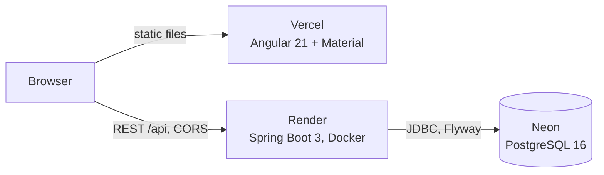

# ACME Corp Salary Platform

Web app for an HR Manager to manage the salaries of 10,000 employees across the US, India and the UK, and to see how the organisation pays people by country and by job title.

| | |
|---|---|
| **Live app** | https://acme-salary-management-eosin.vercel.app |
| **API** | https://acme-salary-api-xawz.onrender.com (for example `/api/insights/countries`) |
| **Demo video** | https://drive.google.com/file/d/1BSc9mWmn1xSEHWwC1XRbrFZ8U00Khub_/view?usp=sharing |

> The API runs on a free host that sleeps after 15 idle minutes. The first request after a quiet period can take about a minute (Render wakes the container, then Neon wakes the database). Open the app once and wait before judging speed.

## What it does
- **Employee directory:** server-side paging, search by name or email, filters for country, department and salary range, a live count of matching records, add, view, edit, delete, bulk delete, and a Clear filters button.
- **Salary insights:** minimum, maximum, average and headcount per country; average salary by job title and by department for a chosen country; a side-by-side comparison of one job title across countries. Charts have text tables as alternatives.
- **Automated seeding:** 10,000 deterministic employees are created on first startup, safe to restart, no UI trigger.
- **Not built (listed as future work):** CSV export and import.

## Architecture

Backend layers, packaged by feature (`employee`, `insights`, `seed`, `common`): controller → service (interface + implementation) → repository → database. DTO records at the API boundary, Bean Validation on input, one `@ControllerAdvice` for every error. Frontend: standalone components, signals and reactive forms, lazy-loaded routes.

## Run it locally
Needs Java 17, Node 20.19+ (or 22.12+), and Docker.

```bash
# 1. Database
docker run -d --name acme-salary-db -e POSTGRES_USER=salary -e POSTGRES_PASSWORD=salary \
  -e POSTGRES_DB=salary -p 5432:5432 postgres:16-alpine

# 2. Backend on :8080 (Flyway creates the schema, the seeder adds 10,000 employees)
cd backend && ./mvnw spring-boot:run

# 3. Frontend on :4200
cd frontend && npm ci && npm start
```
If `npm ci` crashes on npm 10.8, use `npx -y npm@11 ci`. Restart the backend after backend code changes; the frontend reloads itself.

Settings come from environment variables, with local defaults: `DB_URL`, `DB_USERNAME`, `DB_PASSWORD`, `CORS_ALLOWED_ORIGINS`, `PORT`. No secrets are in the repository.

## Tests
```bash
cd backend && ./mvnw test     # 140 tests; repository and integration tests start PostgreSQL in Docker
cd frontend && npm test       # 190 specs (Vitest + jsdom, no browser needed)
```
The backend uses Mockito for services, `@WebMvcTest` for controllers and Testcontainers for repositories and full-stack checks. Every step was written test first; the failing run is recorded in the commit history and the [prompt log](docs/ai/prompt-log.md).

## API
| Method and path | Purpose |
|---|---|
| `GET /api/employees` | Page of employees; `search`, `country`, `department`, `minSalary`, `maxSalary`, `page`, `size` (max 100) |
| `GET /api/employees/{id}` · `POST` · `PUT /{id}` · `DELETE /{id}` | Read, create, update, delete one employee |
| `DELETE /api/employees` | Delete several by `{"ids": [...]}`; all or nothing |
| `GET /api/employees/departments` · `/job-titles` | Distinct values for the dropdowns |
| `GET /api/insights/countries` | Min, max, average, headcount per country |
| `GET /api/insights/countries/{country}/job-titles` · `/departments` | Average salary by job title or department, highest first |

Errors always use one body shape: `{status, message, errors[]}`.

## Decisions and trade-offs
Full reasoning is in [docs/adr/](docs/adr/) and [docs/requirements.md](docs/requirements.md). The short version:
- **Money is exact.** `BigDecimal` in Java and `DECIMAL(15,2)` in SQL. JPQL `AVG` returns a double, so queries return sum and count and the service divides (2 dp, HALF_UP).
- **No currency conversion.** Salaries stay in local currency and insights are per country. The job-title comparison shows three amounts side by side with their codes and never ranks them, because that would treat USD, INR and GBP as one unit.
- **Insights are computed in the database** (`GROUP BY`), not in Java memory.
- **Seeding is code, not a migration,** so it can be tested. It is idempotent (runs only on an empty table) and deterministic (fixed random seed, same data every time).
- **PostgreSQL everywhere, including tests** (Testcontainers), instead of H2, so SQL dialect bugs cannot hide.
- **No authentication,** because the brief assumes one trusted HR session. Instead: validated input, parameterised queries only, security headers, CORS limited to the frontend origin, request logs that never contain query strings or bodies.
- **Frontend choices:** one `query` signal drives the list, so each change sends one request and stale responses are dropped; `chart.js` is used directly (the Angular wrapper needs a newer Angular) and loads only on the insights page.
- **Simplicity over frameworks:** two small servlet filters rather than Spring Security; no layers or abstractions beyond what the current features need.

## Performance
Measured on a local database with about 10,000 rows (single warm requests with `curl`, so indicative, not a benchmark):

| Operation | Time |
|---|---|
| Seeding 10,000 employees (JDBC batch, one transaction) | about 75 to 120 ms |
| Employee page (20 rows) | about 25 ms |
| Search `asha` in India | about 6 ms |
| Country statistics, job-title or department averages | 3 to 5 ms |

Why: indexes on email (unique), country, job title and department; aggregation and sorting in the database; paging capped at 100 rows; the first screen of the app is about 390 kB (99 kB transferred) and the charts load only on the insights page.

## Deployment
Free tiers: Vercel (frontend), Render (Docker backend), Neon (PostgreSQL). Step-by-step guide, free-tier limits and what happens when they run out: [docs/deployment.md](docs/deployment.md).

## How AI was used
Built with Claude Code, one small step per prompt, tests first. The rules the tool followed are in [CLAUDE.md](CLAUDE.md); every prompt, what I checked and what I changed is in [docs/ai/prompt-log.md](docs/ai/prompt-log.md); the plan is in [docs/development-plan.md](docs/development-plan.md). I wrote the requirements and decisions, reviewed each step, and committed the work myself.

## Documentation
- [Requirements](docs/requirements.md): goal, scope, what was left out and why
- [Architecture decisions](docs/adr/): stack, database and testing, seeding and currency, deployment
- [Development plan](docs/development-plan.md): design and build order
- [Deployment guide](docs/deployment.md)
- [AI workflow](docs/ai/): prompt template and prompt log

## Future improvements
CSV export of the filtered list and import with a preview; authentication and an audit trail; linking departments to job titles so inconsistent pairs cannot be saved; one backend endpoint for the job-title comparison; exchange rates for global insights; request rate limiting; dark mode.
